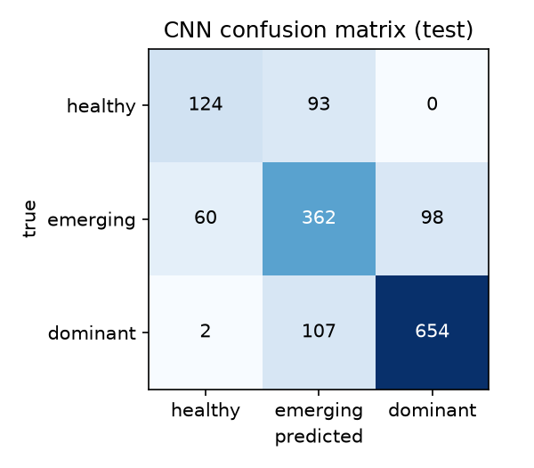
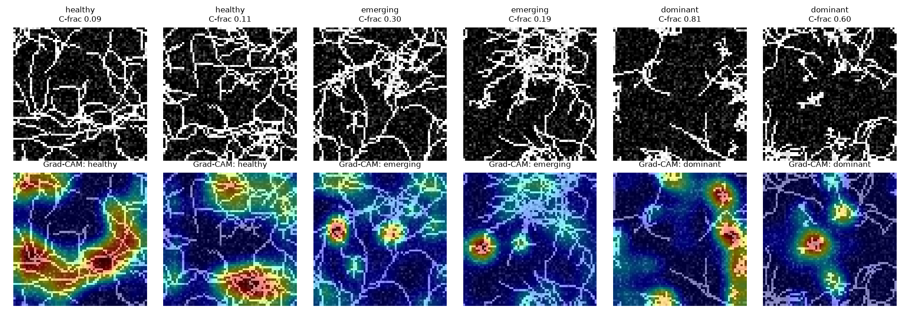

# P4 — CNN classification of hyphal morphology, with Grad-CAM

**Question.** Can a small CNN tell, from a single micrograph, how far a colonial
C-variant has spread through a filamentous fungal culture? And does it look at
the right structures when it decides?

> Synthetic data. The images come from a procedural generator
> ([`fermsim/morphology.py`](fermsim/morphology.py)), not from real microscopy.
> Wild-type hyphae are drawn long and sparsely branched. C-variant hyphae are
> short and densely branched (branch probability 0.45 vs 0.04). This was built in
> November 2026, with AI assistance, as preparation for a PhD application.

## Setup

| | |
|---|---|
| Input | 64×64 grayscale image, with noise |
| Classes | healthy (C-fraction < 0.15) · emerging (0.15–0.5) · dominant (> 0.5) |
| Data | 5,000 train / 1,000 validation / 1,500 test, generated independently (different seeds) |
| Baseline | Gradient boosting on 5 hand-crafted features (pixel density, branch-point density, end-point density, mean, std) |
| Model | 3-block CNN (16-32-64 channels, BatchNorm, global average pooling), random 90° rotations and flips as augmentation, AdamW with early stopping |
| Seeds | 3 CNN seeds; mean ± std reported |

## Results

| Model | Accuracy | Macro-F1 |
|---|---|---|
| Hand-crafted features + gradient boosting | 0.686 | 0.613 |
| **CNN** | **0.755 ± 0.004** | **0.710 ± 0.007** |

Confusion matrix (test set, seed 0; rows are the true class):

| | → healthy | → emerging | → dominant |
|---|---|---|---|
| healthy | 124 | 93 | 0 |
| emerging | 60 | 362 | 98 |
| dominant | 2 | 107 | 654 |





## What the results show

- **The CNN beats the hand-crafted baseline by about 7 accuracy points and 10 macro-F1 points.** It is picking up spatial structure that global pixel statistics miss.
- **Nearly all errors are between neighbouring classes.** Only 2 of 1,500 test images were confused between healthy and dominant. This is expected: the labels are thresholds cut through a continuous quantity (the C-fraction), so images near 0.15 or 0.5 are genuinely ambiguous.
- **Healthy is the weakest class** (recall 57%). At a C-fraction of 0.10–0.15, a 64×64 field of view may contain no colonial hyphae at all, so some of these errors cannot be fixed from one image.
- **Grad-CAM.** For *dominant* predictions the network attends to the compact, densely branched colonial clusters. For *healthy* predictions it attends to regions of long, unbranched hyphae. For *emerging* it highlights small isolated branching points rather than the largest dense cluster. That is plausible, but it is a correlation-based explanation, not proof of what the model uses.

## Limitations and next steps

- Synthetic images are much cleaner than real micrographs. Real ones have focus blur, overlapping hyphae, debris and uneven illumination. The obvious next step is to test on real images and use self-supervised pre-training on unlabelled micrographs.
- The three-class split throws away information. **Ordinal regression**, or regressing the C-fraction directly with an uncertainty estimate, would make better use of the labels.
- One image is one field of view. In practice several fields per sample would be aggregated, for example with multiple-instance learning.
- Grad-CAM should be checked with sanity tests such as model-randomisation and data-randomisation checks before anyone relies on it.

## Run

Python 3.12, CPU only.

```bash
pip install -r requirements.txt
python train.py    # about 10 min on a CPU; this script generates its own images
```

## Part of a four-project series

These four projects share one simulated fermentation process: a chemostat with a colonial C-variant, plant drift, and sensor, micrograph and proteomics data. Each project's results motivate the next, and together they point towards hybrid mechanistic–ML models. References to P1–P4 in this README mean:

| | Project |
|---|---|
| P1 | [Physics-informed neural network for fermentation kinetics](https://github.com/GHUSER/pinn-fermentation-kinetics) |
| P2 | [Early quality prediction with conformal intervals](https://github.com/GHUSER/fermentation-quality-forecasting) |
| P3 | [Multimodal cross-attention for C-variant detection](https://github.com/GHUSER/multimodal-cvariant-detection) |
| P4 | [Morphology CNN with Grad-CAM](https://github.com/GHUSER/hyphal-morphology-cnn-gradcam) (this repository) |
